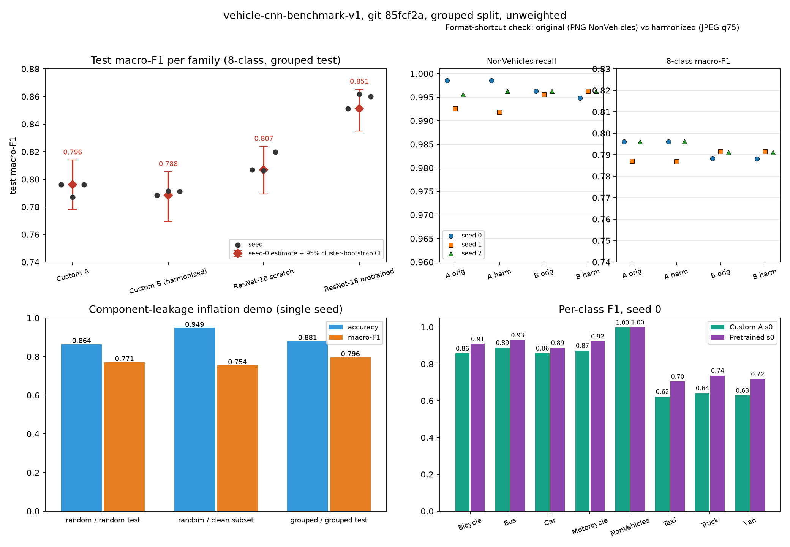

# Vehicle Classification CNN

Can small CNNs classify vehicle photos into eight classes without
cheating on near-duplicate images or JPEG artifacts? This project
trains a custom CNN, ResNet-18 from scratch and pretrained ResNet-18
under a frozen leakage-controlled protocol on 26,378 vehicle images,
with pHash component grouping, a format-harmonized arm and an
inflation demo.



The figure follows the grouped test run: (a) test macro-F1 per
family, (b)-(c) row-normalized confusion matrices for Custom A and
pretrained ResNet-18, (d)-(e) the JPEG/PNG format-shortcut checks,
(f) the component-leakage inflation demo, (g) per-class F1 at seed 0.

## Results

Grouped test (n = 3,955), kernel v1 @ `85fcf2a`, Tesla T4. Macro-F1 is
mean ± sd over seeds 0/1/2; the CI is the seed-0 cluster bootstrap.

| Family | Accuracy | Macro-F1 | Seed-0 macro-F1 95% CI |
| :--- | ---: | ---: | --- |
| Custom A | 0.8765 ± 0.0040 | 0.7931 ± 0.0053 | [0.7784, 0.8140] |
| Custom B (harmonized) | 0.8759 ± 0.0022 | 0.7903 ± 0.0017 | [0.7693, 0.8055] |
| ResNet-18 scratch | 0.8909 ± 0.0056 | 0.8110 ± 0.0076 | [0.7893, 0.8239] |
| ResNet-18 pretrained | 0.9166 ± 0.0034 | 0.8576 ± 0.0057 | [0.8351, 0.8653] |

- **Pretrained ResNet-18 is the clear winner.** Macro-F1 0.8576 vs
  0.7931 for Custom A, a paired difference of +0.0550 [+0.0381,
  +0.0718]; accuracy 0.9166 vs 0.8765.
- **The format checks find no JPEG shortcut.** Custom B trained on
  harmonized images matches Custom A (macro-F1 -0.0078 [-0.0218,
  +0.0055]) and NonVehicles recall stays 0.992-1.000 in both formats.
- **There is no measurable leakage inflation, but see Notes.** The
  random-split model scores macro-F1 0.7709 on its own test vs 0.7961
  for Custom A on grouped test; on the clean subset its accuracy is
  0.9485 but macro-F1 only 0.7542.
- **Remaining errors concentrate in Taxi, Van and Truck.** Custom A
  recalls them at 0.50, 0.58 and 0.68; pretrained improves to 0.65,
  0.72 and 0.77 while NonVehicles recall stays near 1.0, so the
  7-vehicle-class F1 (pretrained 0.830-0.842) is the informative one.

## How it works

```text
vehicle_classification.zip -> sha256 fingerprint -> pHash audit
(threshold 6, largest component 28 images) -> grouped 70/15/15 split,
seed 42, atomic over components -> JPEG forensics (quality 75, 4:2:0)
-> unweighted chosen on validation -> AdamW cosine training, seeds
0/1/2 -> freeze analysis_plan.json -> decode test once -> grouped
metrics + format arm + random-split inflation demo + cluster bootstrap
```

## Run it

```bash
uv sync
uv run pytest        # synthetic fixtures only, no real data
uv run ruff check .
uv run mypy src
scripts/kaggle_run.sh --smoke   # diagnostic kernel
scripts/kaggle_run.sh           # full GPU kernel on Kaggle
```

## Notes

- The leakage comparison spans two different test sets at a single
  seed, so it is one comparison, not proof of no inflation.
- The PNG-to-JPEG test found no format shortcut, but the NonVehicles
  images may still differ from vehicle photos in other ways (a
  different source collection is only a hypothesis).
- Most models trained to the epoch limit: best epochs cluster at the
  end of the cosine schedule, so results are for these fixed budgets.
- Dataset provenance and license are unknown (local archive); protocol
  `vehicle-cnn-benchmark-v1`, split seed 42, model seeds 0/1/2,
  bootstrap seed 0. `results/` is unedited kernel output and
  `image.png` renders from it.
